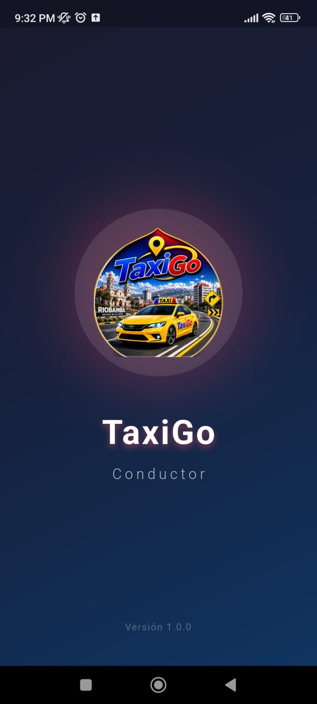
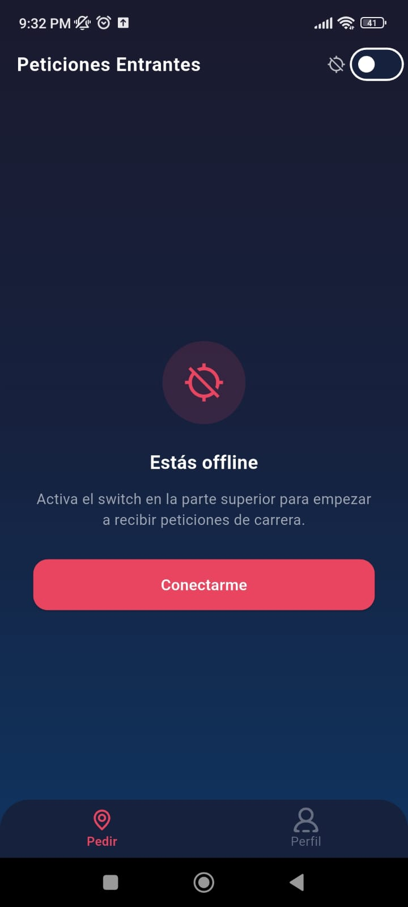
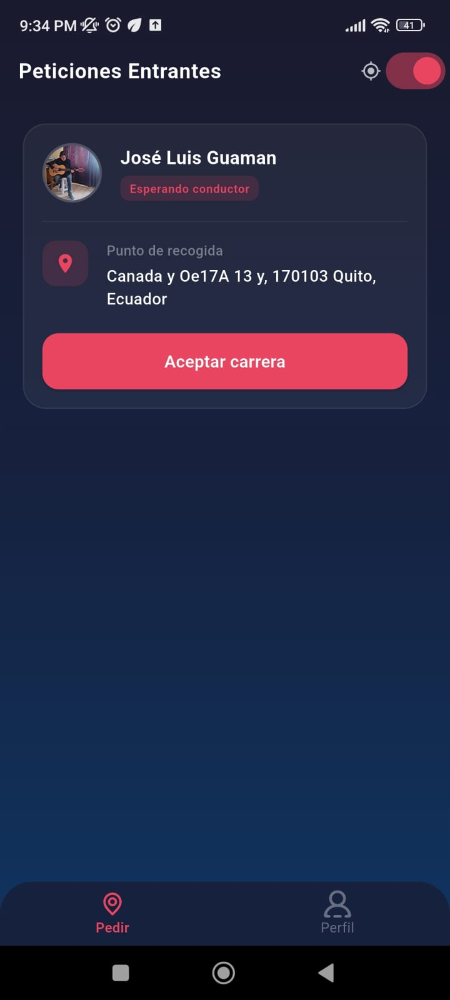
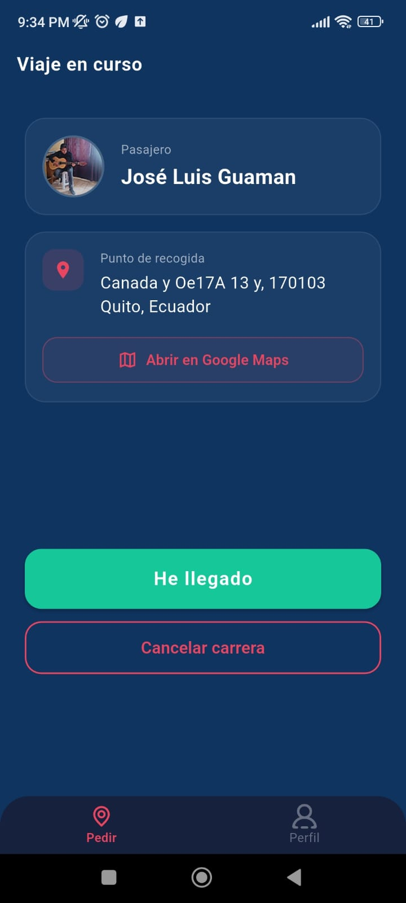
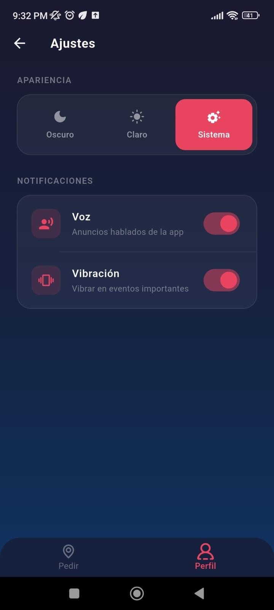
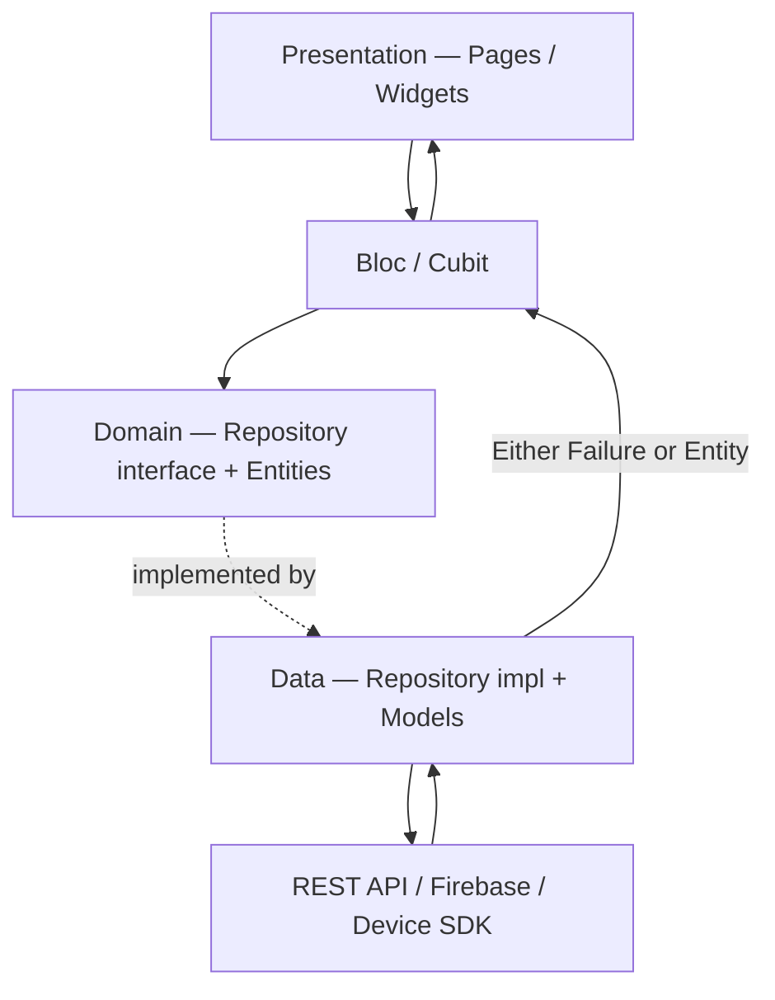
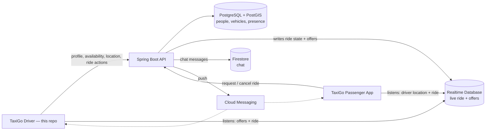

<div align="center">


# TaxiGo Driver

**The driver-side app of TaxiGo — a real-time taxi dispatch platform built for the city of Riobamba, Ecuador.**

[](https://flutter.dev)
[](https://dart.dev)
[](https://firebase.google.com)
[]()
[](https://github.com/areascript22/project-taxi-driver/actions/workflows/deploy_qa.yml)
[](https://github.com/areascript22/project-taxi-driver/actions/workflows/deploy_prod.yml)
[]()

[Overview](#-overview) • [Screenshots](#-screenshots) • [Features](#-key-features) • [Architecture](#-architecture) • [Tech Stack](#-tech-stack) • [Testing](#-testing) • [CI/CD](#-cicd) • [Getting Started](#-getting-started)

</div>

---

## 📖 Overview

**TaxiGo Driver** is the driver-facing half of **TaxiGo**, a two-sided, real-time taxi-hailing system made of three pieces:

| Piece | Repository | Role |
|---|---|---|
| **TaxiGo Driver** (this repo) | `project-taxi-driver` | Drivers go online, receive ride offers, run the trip |
| **TaxiGo** (passenger app) | [`project-taxi-passenger`](https://github.com/areascript22/project-taxi-passenger) | Riders request and track a taxi |
| **TaxiGo backend** | `taxi-backend` (private) | Spring Boot API + PostgreSQL/PostGIS. Source of truth for people, dispatch and the ride lifecycle |

It is not a CRUD toy: it solves the problems a real dispatch platform has to solve — **race conditions between drivers competing for the same ride**, **background location that survives OEM battery managers**, **a presence switch that must never disagree with the server**, **offline/latency-tolerant UX** and **driver verification through an in-app admin back-office**.

## 📱 Screenshots

<table>
<tr>
<td align="center"><br/><sub><b>Splash</b></sub></td>
<td align="center"><br/><sub><b>Offline state</b></sub></td>
<td align="center"><br/><sub><b>Incoming ride request</b></sub></td>
</tr>
<tr>
<td align="center"><br/><sub><b>Trip in progress</b></sub></td>
<td align="center"><br/><sub><b>Settings</b></sub></td>
<td></td>
</tr>
</table>

## ✨ Key Features

- 🔐 **Two ways to sign in** (Firebase Auth) — **Google**, or **email and password** with a full flow: sign-up, mandatory **email verification** (an unverified account is signed out and never gets in), and **password reset**. Both lead to the same session flow.
- 🧑‍💼 **Driver onboarding** — personal data, mandatory profile photo and vehicle (plate, brand, model, year, colour). Ecuadorian mobile numbers are formatted as you type.
- ✅ **Approval workflow** — new drivers start `pending`; the app routes to *in review*, *rejected* (with the reason) or *blocked* screens until an admin approves them.
- 📡 **Ride offers, not a firehose** — the server offers each ride to the nearest available drivers in expanding rings; the app listens to its own offer tray in Firebase Realtime Database and shows a countdown per request.
- 🚕 **Full trip lifecycle** — accept → arrived → in progress → completed / cancelled. Every transition is enforced **server-side** so two drivers can never take the same ride.
- 🗣️ **Voice + vibration alerts** — the app speaks the pickup *sector* and vibrates on each new request, driven from a **foreground-service isolate**, so it works with the app closed.
- 🛰️ **Resilient background location** — a foreground service reports GPS while online, with a battery-optimisation exemption flow (including MIUI's delayed permission reconciliation). If GPS is off or unavailable the driver cannot go online, and while online a persistent warning appears after ~15 s of failures.
- 🔄 **Server-authoritative online switch** — on entering the screen and on resume the app reads the driver's real state from the server and reconciles the local service (stop it, resume it, or keep the local state if offline).
- 💬 **Realtime chat** with the passenger during a trip.
- 🔔 **Push notifications** (FCM) for assignments and cancellations while the app is killed, in the user's language.
- 🛠️ **Admin back-office** — search, paginate, filter by status; approve, reject, block, change role or delete drivers, with a role hierarchy (`driver` < `admin` < `superuser`).
- 🌐 **Spanish / English** (official `gen-l10n`), with a language selector and light/dark/system theme.
- 🧭 **Native navigation handoff** — open the pickup in the user's maps app.
- ⬆️ **Forced-update gate** — the server can require a minimum app version.

## 🏗️ Architecture

Feature-based **Clean Architecture**, enforced by convention (see [`CLAUDE.md`](./CLAUDE.md) for the internal style guide):

```
UI  →  Bloc / Cubit  →  Repository / Service  →  REST API · Firebase · Device SDK
```

- **No `datasource` layer** — repositories talk to the API, Firebase or the device SDK directly.
- **Functional error handling** — every repository method returns `Future<Either<Failure, Entity>>` (`dartz`). Exceptions never propagate; they become a `Failure` carrying a `FailureCode`, and the UI alone decides the localized text.
- **Model ↔ Entity separation** — models (de)serialize, entities are plain business objects.
- **Dependency Injection** — each feature owns a `get_it` locator (`init<Feature>DI`).

<div align="center">



</div>

### The bigger picture

<div align="center">



</div>

The API owns every state transition; Realtime Database is only the low-latency fan-out to both apps. Profiles, vehicles and driver presence live in PostgreSQL/PostGIS, which is what makes "nearest available driver" a spatial query.

### Project structure

```
lib/
 ├─ core/            # Dio client, error codes, theme, routing, l10n helpers
 ├─ shared/          # Cross-feature: geolocation, voice, vibration, notifications,
 │                   # foreground service, presence, session, settings, connectivity
 └─ feature/
     ├─ auth/              # Google + email/password sign-in, sign-up, password reset
     ├─ driver_profile/    # Onboarding (driver + vehicle)
     ├─ incoming_request/  # Ride offers feed, online/offline switch
     ├─ trip/              # Trip lifecycle (arrive / start / complete / cancel)
     ├─ chat/              # Realtime chat with the passenger
     ├─ profile/           # Driver profile and vehicle
     ├─ admin/             # Driver back-office
     └─ app_update/        # Minimum-version gate
         ├─ presentation/  # screens, widgets, bloc
         ├─ domain/        # entities, repository contracts
         ├─ data/          # repository implementation + models
         └─ di/            # feature-scoped service locator
```

## 🧰 Tech Stack

| Category | Technology |
|---|---|
| Language & framework | Dart 3.7, Flutter 3.29 |
| State management | `flutter_bloc` / `bloc` |
| Dependency injection | `get_it`, one locator per feature |
| Error handling | `dartz` (`Either<Failure, T>`) |
| Networking | `dio` + `dio_smart_retry` |
| Realtime | `firebase_database` |
| Auth / storage / chat | `firebase_auth`, `google_sign_in`, `firebase_storage`, `cloud_firestore` |
| Push | `firebase_messaging`, `flutter_local_notifications` |
| Location & background | `geolocator`, `flutter_background_service`, `permission_handler` |
| Voice & haptics | `flutter_tts`, `vibration` |
| i18n | `flutter_localizations`, `intl` (`gen-l10n`, es/en) |
| Routing | `go_router` |
| Config | `flutter_dotenv` (per-flavor `.env`) |
| Testing | `flutter_test`, `bloc_test`, `mocktail` |
| CI/CD | GitHub Actions → Google Play (internal track) |

## ✅ Testing

**430+ automated tests**: pure unit tests for helpers, repository tests with mocked Dio / `FirebaseAuth`, a `bloc_test` suite for every Bloc, and widget tests for key components. Each Bloc covers its initial state, success and failure paths, guard clauses and — for stream-backed Blocs — the full emitted sequence including stream errors.

```bash
flutter test
```

## 🚀 CI/CD

| Branch | Workflow | Result |
|---|---|---|
| `qa` | [`deploy_qa.yml`](.github/workflows/deploy_qa.yml) | Builds the signed **dev-flavor** App Bundle (`com.areascript.driver_app.dev`) and uploads it to the Play **internal** track as a draft |
| `main` | [`deploy_prod.yml`](.github/workflows/deploy_prod.yml) | Builds the signed **prod-flavor** App Bundle (`com.areascript.driver_app`) with the production keystore and uploads it to the Play **internal** track as a draft, to be promoted by hand |

Each workflow reads its secrets from a GitHub **Environment** (`qa` / `production`): the `.env` file, `google-services.json`, the signing keystore and the Play service-account key. Release flow: `dev` → PR → `qa` (internal test build) → PR → `main` (production build).

## 🏁 Getting Started

```bash
git clone https://github.com/areascript22/project-taxi-driver.git
cd project-taxi-driver
flutter pub get
```

**1. Environment variables** — the app reads its backend URL from a per-flavor `.env` file (default `assets/env/.env_dev`, overridable with `--dart-define=ENV_FILE=...`):

```env
BASE_URL=https://your-backend.example.com
```

**2. Firebase** — `google-services.json` is not in the repo (CI injects it). Add your own under `android/app/src/dev/` (and `prod/`), e.g. with [FlutterFire](https://firebase.flutter.dev/docs/cli/). Enable the **Google** and **Email/Password** providers in Firebase Authentication.

**3. Run** — always pass a flavor; a bare build targets prod:

```bash
flutter run --flavor dev --dart-define=ENV_FILE=assets/env/.env_dev --dart-define=FLAVOR=dev
```

## 🔗 Related repositories

- 🙋 **[TaxiGo (passenger app)](https://github.com/areascript22/project-taxi-passenger)** — the rider-facing Flutter app, same architecture.
- ☕ **TaxiGo backend** — private Spring Boot API with PostgreSQL/PostGIS that owns people, dispatch and ride-state transitions.

---

<div align="center">

Built and maintained by **[@areascript22](https://github.com/areascript22)** — feel free to reach out.

</div>
